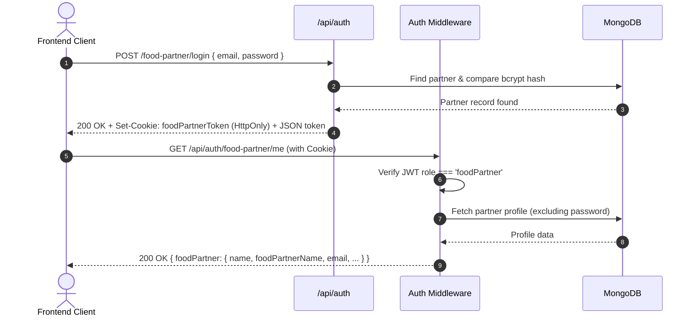
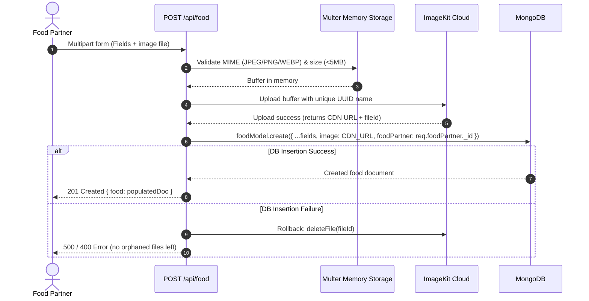

# 🍔 FoodNest - Full-Stack Food Delivery & Partner Platform

A modern, full-stack food delivery and restaurant management ecosystem built with **React 19**, **Vite**, **Tailwind CSS**, **Node.js**, **Express 5**, **MongoDB**, and **ImageKit**.

FoodNest bridges hungry customers with local restaurants (Food Partners) through a dedicated dual-role architecture, robust media asset handling, secure JWT-based authentication, and modern UI design.

---

## 📑 Table of Contents

- [Overview & Vision](#-overview--vision)
- [Architecture & System Flow](#-architecture--system-flow)
- [What Has Been Built So Far](#-what-has-been-built-so-far)
  - [Backend Features](#1-backend-services--apis)
  - [Frontend Features](#2-frontend-application)
- [File & Folder Structure](#-file--folder-structure)
- [API Reference](#-api-reference)
- [Getting Started & Local Setup](#-getting-started--local-setup)
- [Project Flow: What To Check Before Continuing](#-developer-onboarding-what-to-look-at-first)
- [Future Roadmap & Next Steps](#-future-roadmap--next-steps)

---

## 🌟 Overview & Vision

FoodNest is designed with a **two-sided marketplace** mental model:
1. **Customers (Users)**: Discover dishes, browse menus, customize carts, and place food orders.
2. **Food Partners (Restaurants)**: Register restaurants, curate digital menus with rich image assets, monitor incoming orders, and control item availability.

---

## 📐 Architecture & System Flow

### High-Level Architecture

```
┌─────────────────────────────────────────────────────────────────┐
│                    FoodNest Client (React 19)                   │
├───────────────────────────────┬─────────────────────────────────┤
│    Customer Interface         │    Food Partner Portal          │
│    - Landing Page (Home)      │    - Partner Registration       │
│    - User Login & Register    │    - Partner Login              │
│    - Menu Browsing (Upcoming) │    - Protected Dashboard        │
└───────────────┬───────────────┴─────────────────┬───────────────┘
                │ HTTP (Axios / Cookies + JWT)    │
                ▼                                 ▼
┌─────────────────────────────────────────────────────────────────┐
│                  FoodNest Backend API (Express 5)               │
├─────────────────────────────────────────────────────────────────┤
│  Middlewares: Auth Guards (Role-Based), Multer Memory Storage   │
├───────────────────────────────┬─────────────────────────────────┤
│  Auth Routes & Controllers    │  Food Routes & Controllers      │
└───────────────┬───────────────┴─────────────────┬───────────────┘
                │                                 │
     ┌──────────┴──────────┐           ┌──────────┴──────────┐
     ▼                     ▼           ▼                     ▼
┌──────────────┐     ┌─────────────┐ ┌──────────────┐  ┌─────────────┐
│ MongoDB      │     │ ImageKit    │ │ MongoDB      │  │ ImageKit    │
│ (Users &     │     │ Cloud       │ │ (Food Items  │  │ (Image CDN  │
│  Partners)   │     │ (Storage)   │ │  Collection) │  │  Delivery)  │
└──────────────┘     └─────────────┘ └──────────────┘  └─────────────┘
```

### 1. Dual-Role Authentication & Session Flow



### 2. Food Item Creation & Media Pipeline



---

## 🚀 What Has Been Built So Far

### 1. Backend Services & APIs

- **Environment & Server Architecture**:
  - Modular Express application (`backend/server.js` + `backend/src/app.js`).
  - Strict CORS support configured with credentials (`http://localhost:5173`).
  - Centralized database connector (`backend/src/db/db.js`).

- **Dual-Role Authentication Engine (`backend/src/controllers/auth.controller.js`)**:
  - Independent cookie streams: `userToken` for customers, `foodPartnerToken` for restaurants.
  - Role payload encoded directly into signed JWT tokens.
  - Safe profile endpoint `GET /api/auth/food-partner/me` to hydrate dashboard sessions.
  - Secure bcrypt password hashing (salt rounds: 10).
  - Robust field validation (email regex, required fields, minimum password length).

- **Role-Based Middlewares (`backend/src/middlewares/auth.middleware.js`)**:
  - `authFoodPartnerMiddleware`: Enforces `foodPartnerToken` cookie, validates role, attaches `req.foodPartner`.
  - `authUserMiddleware`: Enforces `userToken` cookie, validates role, attaches `req.user`.

- **Media Upload & Storage System (`backend/src/middlewares/upload.middleware.js` & `backend/src/services/storage.service.js`)**:
  - Memory-buffered Multer uploads preventing disk clutter.
  - Strict MIME validation for JPEG, JPG, PNG, and WEBP.
  - 5MB maximum file size limit.
  - ImageKit integration uploading directly to `/foodnest/food-images`.
  - Automatic rollback / orphan cleanup: Deletes the uploaded ImageKit file if database document creation encounters an error.

- **Food Item Lifecycle Management (CRUD) (`backend/src/controllers/food.controller.js`)**:
  - `createFood`: Validates fields, processes image, binds `foodPartner` ObjectId.
  - `getAllFood`: Public endpoint with query filters (`category`, `foodPartner`, `isAvailable`) and case-insensitive regex search (`search`).
  - `getFoodById`: Fetches single food item populated with partner details (`name`, `foodPartnerName`, `email`, `phone`, `address`).
  - `updateFood`: Validates ownership (partners can only update their own items) and supports updating details and replacing images.
  - `deleteFood`: Enforces ownership and removes item from MongoDB.

- **Data Models (`backend/src/models/`)**:
  - `user.model.js`: `fullName`, `email` (unique), `password`, timestamps.
  - `foodpartener.model.js`: `name` (owner), `foodPartnerName` (restaurant), `email` (unique), `password`, `address`, `phone`.
  - `food.model.js`: `name`, `description`, `price`, `category`, `image`, `video` (optional), `isAvailable`, `foodPartner` (ref to `foodpartner`), timestamps.

---

### 2. Frontend Application

- **Modern Tech Stack**:
  - **React 19** with **Vite 8** for fast HMR.
  - **Tailwind CSS v4** for clean UI styling.
  - **React Router v7** for declarative client-side routing.
  - **Axios** with `withCredentials: true` for cookie-based cross-origin communication.

- **Landing Page (`frontend/src/pages/general/Home.jsx`)**:
  - Hero banner with animated gradients, dynamic CTA buttons for ordering and restaurant onboarding.
  - "How It Works" 3-step feature breakdown.
  - Floating delivery badge highlights.

- **Customer Authentication Flow**:
  - `UserRegister.jsx`: Interactive registration with real-time error banners and local storage persistence.
  - `UserLogin.jsx`: Login with redirect handling.

- **Food Partner Portal**:
  - `FoodPartnerRegister.jsx`: Comprehensive restaurant onboarding form with terms checkbox, input validation, and loading spinners.
  - `FoodPartnerLogin.jsx`: Secure partner sign-in with clear feedback.
  - `FoodPartnerDashboard.jsx`: Partner command center with:
    - Dynamic greeting & restaurant profile card.
    - Key metrics (Total Dishes, Active Orders, Today's Sales, Rating).
    - Quick actions (Add Food Item, Manage Menu, Incoming Orders, Profile Settings).
    - Session logout with cookie invalidation.
  - `ProtectedPartnerRoute.jsx`: Route guard preventing unauthorized access to partner pages, with redirection to `/food-partner/login`.

- **Reusable UI & Utilities**:
  - `FormAlert.jsx`: Accessible alert banner supporting `error`, `success`, `warning`, and `info` types with dismiss animation.
  - `errorHandler.js`: Centralized error string extractor handling backend JSON responses, validation errors, and network issues.

---

## 📂 File & Folder Structure

```
foodnest/
├── backend/
│   ├── src/
│   │   ├── controllers/
│   │   │   ├── auth.controller.js       # Customer & Partner authentication + /me
│   │   │   └── food.controller.js       # Food CRUD, ImageKit upload & filters
│   │   ├── db/
│   │   │   └── db.js                    # Mongoose MongoDB connection
│   │   ├── middlewares/
│   │   │   ├── auth.middleware.js       # JWT & role verification guards
│   │   │   └── upload.middleware.js     # Multer memory storage & MIME filters
│   │   ├── models/
│   │   │   ├── food.model.js            # Food item schema & validations
│   │   │   ├── foodpartener.model.js    # Restaurant partner schema
│   │   │   └── user.model.js            # Customer user schema
│   │   ├── routes/
│   │   │   ├── auth.routes.js           # Auth endpoint definitions
│   │   │   └── food.routes.js           # Food endpoint definitions
│   │   ├── services/
│   │   │   └── storage.service.js       # ImageKit SDK client & deletion
│   │   └── app.js                       # Express app configuration & middlewares
│   ├── server.js                        # App entry point (port 3000)
│   └── package.json
│
├── frontend/
│   ├── src/
│   │   ├── components/
│   │   │   ├── auth/
│   │   │   │   └── ProtectedPartnerRoute.jsx  # Protected route wrapper
│   │   │   └── FormAlert.jsx                  # Reusable dismissible alert component
│   │   ├── pages/
│   │   │   ├── auth/
│   │   │   │   ├── FoodPartnerLogin.jsx       # Partner login page
│   │   │   │   ├── FoodPartnerRegister.jsx    # Partner registration page
│   │   │   │   ├── UserLogin.jsx              # Customer login page
│   │   │   │   └── UserRegister.jsx           # Customer registration page
│   │   │   ├── foodPartner/
│   │   │   │   └── FoodPartnerDashboard.jsx   # Partner dashboard
│   │   │   └── general/
│   │   │       └── Home.jsx                   # Main landing page
│   │   ├── routes/
│   │   │   └── AppRoutes.jsx                  # Application routing definitions
│   │   ├── utils/
│   │   │   └── errorHandler.js                # Centralized error formatter
│   │   ├── App.jsx
│   │   └── main.jsx
│   ├── package.json
│   └── vite.config.js
│
├── .gitignore
└── README.md
```

---

## 📡 API Reference

### 🔐 Authentication (`/api/auth`)

| Method | Endpoint | Access | Description |
| :--- | :--- | :--- | :--- |
| `POST` | `/api/auth/user/register` | Public | Register a new customer (`fullName`, `email`, `password`) |
| `POST` | `/api/auth/user/login` | Public | Login customer, sets `userToken` cookie |
| `GET` | `/api/auth/user/logout` | Public | Clear customer session cookie |
| `POST` | `/api/auth/food-partner/register` | Public | Register restaurant partner (`name`, `foodPartnerName`, `email`, `password`, `address`, `phone`) |
| `POST` | `/api/auth/food-partner/login` | Public | Login partner, sets `foodPartnerToken` cookie |
| `GET` | `/api/auth/food-partner/logout` | Public | Clear partner session cookie |
| `GET` | `/api/auth/food-partner/me` | Partner | Retrieve current authenticated partner profile |

### 🍕 Food Management (`/api/food`)

| Method | Endpoint | Access | Description |
| :--- | :--- | :--- | :--- |
| `GET` | `/api/food` | Public | Retrieve food list. Query params: `category`, `foodPartner`, `isAvailable`, `search` |
| `GET` | `/api/food/:id` | Public | Get single food item with populated restaurant partner details |
| `POST` | `/api/food` | Partner | Create food item with multipart `image` file and fields (`name`, `description`, `price`, `category`, `isAvailable`) |
| `PUT` | `/api/food/:id` | Partner (Owner) | Update food item fields or replace image |
| `DELETE` | `/api/food/:id` | Partner (Owner) | Delete a food item owned by the authenticated partner |

---

## 🛠️ Getting Started & Local Setup

### Prerequisites
- [Node.js](https://nodejs.org/) (v18 or higher recommended)
- [MongoDB](https://www.mongodb.com/) (Local community edition or MongoDB Atlas URI)
- [ImageKit Account](https://imagekit.io/) (for image hosting API keys)

---

### Step 1: Backend Setup

1. Navigate to the `backend` directory:
   ```bash
   cd backend
   ```

2. Install dependencies:
   ```bash
   npm install
   ```

3. Configure environment variables:
   Create a `.env` file in `backend/` with the following variables:
   ```env
   PORT=3000
   MONGO_URI=mongodb://127.0.0.1:27017/foodnest
   JWT_SECRET=your_super_secret_jwt_key
   IMAGEKIT_PUBLIC_KEY=your_imagekit_public_key
   IMAGEKIT_PRIVATE_KEY=your_imagekit_private_key
   IMAGEKIT_URL_ENDPOINT=https://ik.imagekit.io/your_imagekit_id
   NODE_ENV=development
   ```

4. Start the backend server:
   ```bash
   npm start
   ```
   *The server runs on `http://localhost:3000`.*

---

### Step 2: Frontend Setup

1. Open a new terminal and navigate to `frontend`:
   ```bash
   cd frontend
   ```

2. Install dependencies:
   ```bash
   npm install
   ```

3. Start the Vite development server:
   ```bash
   npm run dev
   ```
   *The application will be accessible at `http://localhost:5173`.*

---

## 🧭 Developer Onboarding: What To Look At First

Before continuing development or adding new features, here is the mental checklist of key architectural files:

1. **Authentication Token Duality**:
   - Look at [backend/src/middlewares/auth.middleware.js](file:///backend/src/middlewares/auth.middleware.js) to understand how `foodPartnerToken` and `userToken` are kept separate.
   - Look at [backend/src/controllers/auth.controller.js](file:///backend/src/controllers/auth.controller.js) to see how cookies and JSON responses are returned simultaneously.

2. **Image Upload Flow**:
   - Inspect [backend/src/middlewares/upload.middleware.js](file:///backend/src/middlewares/upload.middleware.js) for Multer memory limits.
   - Inspect [backend/src/controllers/food.controller.js](file:///backend/src/controllers/food.controller.js) to see the transaction rollback: if saving to MongoDB fails, `storageService.deleteFile(uploadResult.fileId)` cleans up the uploaded ImageKit image.

3. **Frontend Routing & Route Guarding**:
   - Inspect [frontend/src/routes/AppRoutes.jsx](file:///frontend/src/routes/AppRoutes.jsx) to see route definitions and case-insensitive redirects (`/food-partner/*` and `/FoodPartner/*`).
   - Check [frontend/src/components/auth/ProtectedPartnerRoute.jsx](file:///frontend/src/components/auth/ProtectedPartnerRoute.jsx) to see how dashboard routes verify session credentials before rendering.

4. **Frontend Error Handling Convention**:
   - Check [frontend/src/utils/errorHandler.js](file:///frontend/src/utils/errorHandler.js) to follow the unified error parsing pattern across new forms and pages.

---

## 🔮 Future Roadmap & Next Steps

Here is the planned implementation checklist for the next milestones:

- [ ] **Food Partner Dish Management UI**:
  - Add an "Add Dish" modal/page in `FoodPartnerDashboard.jsx` submitting multipart forms to `POST /api/food`.
  - Add "Edit Dish" and "Delete Dish" controls to manage menu items.
- [ ] **Customer Food Feed & Restaurant Discovery**:
  - Build a consumer browse page showing food cards fetched from `GET /api/food`.
  - Add search bar and category filters (Pizza, Burgers, Drinks, Desserts).
- [ ] **Cart & Checkout State Management**:
  - Implement a client-side cart (Zustand or React Context) with item quantity, customization notes, and price calculation.
- [ ] **Order Management System**:
  - Create `order.model.js` (Customer, Items, Restaurant, Total Amount, Delivery Address, Status).
  - Add endpoints: `POST /api/orders`, `GET /api/orders/user`, `GET /api/orders/partner`, `PATCH /api/orders/:id/status`.
  - Order status pipeline: `Placed` ➔ `Accepted` ➔ `Preparing` ➔ `Out for Delivery` ➔ `Delivered`.
- [ ] **Real-Time Order Tracking**:
  - Integrate Socket.io for live status updates between customer and kitchen.
- [ ] **Payment Integration**:
  - Integrate Razorpay / Stripe sandbox checkout for secure payments.

---

## 🤝 Contributing

Contributions, feedback, and pull requests are warmly welcomed! Please open an issue first to discuss substantial architectural changes.

---

*Built with ❤️ for scalable full-stack web engineering.*
